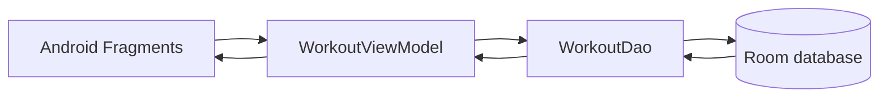

<div align="center">
  <h1>Training Diary</h1>
  <p><strong>A private, local-first log for workouts, body weight, pain, and notes.</strong></p>
  <p>
    
    
    
    
    
  </p>
  <p>
    <a href="#features">Features</a> ·
    <a href="#architecture">Architecture</a> ·
    <a href="#getting-started">Getting started</a> ·
    <a href="#development-roadmap">Development roadmap</a> ·
    <a href="#privacy-and-security">Privacy &amp; security</a>
  </p>
</div>

> [!IMPORTANT]
> ## ACTIVE DEVELOPMENT
> Training Diary is still under active development. Cloud database support, data caching, a notification system, and further improvements are planned for the coming months. These features are **not available yet**. The current app stores workout entries locally on the device.

## Overview

Training Diary is a native Android app for keeping a simple record of training sessions. Each entry can include the workout date, training description, body weight, pain information, and personal notes. The home screen summarizes activity, while the history view makes entries easy to revisit and update.

The current release is local-first: records are stored in an on-device Room database. There is no account system, cloud synchronization, or remote service yet.

## Features

- Create, edit, view, and delete workout entries.
- Record training details, date, body weight, pain, pain description, and notes.
- Review totals, this month's sessions, the latest recorded body weight, and pain entries from the home screen.
- Browse workout history with filters for all entries, entries with pain, or the five most recent entries.
- Persist data locally with Room and observe changes through Android Architecture Components.

## Architecture



The app uses a single `Workout` entity and a Room DAO. Fragments render the interface, Navigation Component handles screen transitions, and a `ViewModel` exposes database results to the UI. Cloud services and caching are roadmap items, not part of the current architecture.

## Technology Stack

| Area | Technologies |
| --- | --- |
| Platform | Android, Kotlin, XML layouts |
| UI | Material Components, Fragments, RecyclerView |
| Navigation | Android Navigation Component |
| Data | Room, LiveData, ViewModel, Kotlin Coroutines |
| Build | Gradle 9.2.1, Android Gradle Plugin 9.0.1, KSP |
| Tests | JUnit, AndroidX Test, Espresso |

## Getting Started

### Requirements

- Android Studio with support for the project's Android Gradle Plugin version
- JDK 21 (the Gradle daemon toolchain is configured for Java 21)
- Android SDK platform 36.1 and a compatible emulator or Android device

### Open And Run

1. Clone this repository and open the project directory in Android Studio.
2. Allow Gradle to sync and install any requested Android SDK components.
3. Select the `app` run configuration and an emulator or connected device.
4. Build and run the app from Android Studio.

To build a debug APK from a terminal:

```bash
./gradlew assembleDebug
```

On Windows, use:

```powershell
.\gradlew.bat assembleDebug
```

The APK is written to `app/build/outputs/apk/debug/`.

## Development Roadmap

The project is actively evolving. Planned work for the coming months includes:

- Cloud database integration and synchronization across devices
- Caching for a more resilient and responsive experience
- A notification system for training reminders and useful updates
- Further improvements to the diary and its reporting features

The roadmap is subject to change. Until cloud synchronization is implemented, the app's data remains on the device and is not shared between installations.

## Privacy And Security

- No API keys, passwords, service-account files, or signing keys are required to build the current version.
- Workout records are stored in the app's local Room database. The current version has no network integration.
- Android automatic backup is disabled in this repository copy because workout notes may contain personal or pain-related information.
- App data is not encrypted by this project. Use a device protected by Android's screen lock, and do not treat the app as a medical-record system.
- Future cloud features will require an explicit security and privacy design before they are introduced.

## Project Structure

```text
training-diary-app/
|-- app/
|   |-- src/main/java/.../data/          # Room entity, DAO, and database
|   |-- src/main/java/.../ui/            # Android fragments
|   |-- src/main/java/.../viewmodel/     # UI state and data access
|   `-- src/main/res/                    # Layouts, navigation, themes, assets
|-- docs/wireframes/                     # Interface planning references
|-- gradle/                              # Wrapper and dependency catalog
`-- README.md
```

## License

No license file is currently included. All rights remain with the project author unless a license is added.
